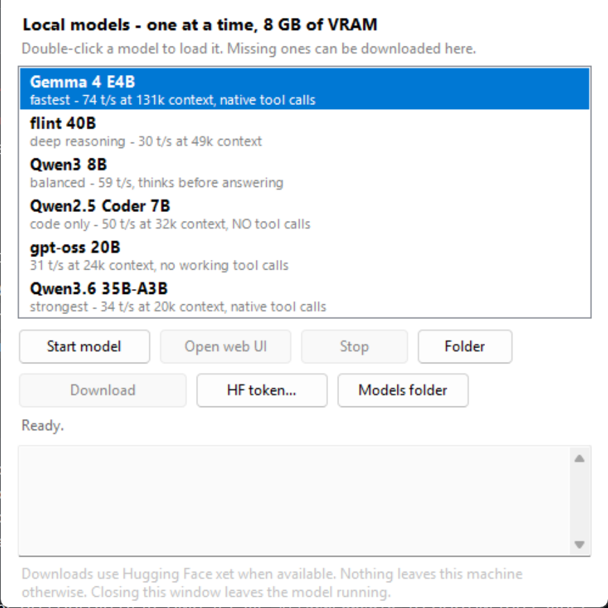

# 40B models on an 8 GB laptop GPU



A local-inference stack for one exact machine - Core Ultra 7 255HX, 32 GB DDR5-5600, RTX 5060 Laptop
with 8 GB - where every flag was measured instead of guessed, and the guesses that turned out wrong
are still in this file with a note saying so.

Two claims worth the click: a **35B mixture-of-experts model at 34 t/s**, and a **4B model at 74 t/s
with a 131072-token context**, both on the same 8 GB card, one at a time.

## At a glance

| model | size | speed | context | tool calls | what it is for |
|---|--:|--:|--:|---|---|
| **Gemma 4 E4B** QAT UD-Q4_K_XL | 4.2 GB | **74.1 t/s** | 131072 | yes | the default: fast, huge context, drives agents |
| **Qwen3.6 35B-A3B** MoE UD-Q4_K_S | 21.7 GB | 34.0 t/s | 20480 | yes | strongest answers that still fit |
| **Qwen3.6 27B-A3B Coder** MoE Q4_K_M | 16.1 GB | **44.4 t/s** | 32768 | yes | code, with the best speed-per-capability here |
| **flint 40B** NVFP4 MoE | 22.9 GB | 29.8 t/s | 49152 | yes | longest context on a big model |
| **gpt-oss 20B** MXFP4 | 13.8 GB | 30.8 t/s | 24576 | no | chat only |
| **Qwen3 8B** Q4_K_M | 5.2 GB | 59.0 t/s | 16384 | yes | small and quick, thinks first |
| **Qwen2.5 Coder 7B** Q4_K_M | 4.7 GB | 50.3 t/s | 32768 | no | code, not agents |

Every context number is the **largest one that completed a real 200-token request** on this machine.
`/health` answering is not proof: one model reports healthy at 24576 and then fails its first
completion. The method, including what had to be thrown away, is in
[docs/how-the-numbers-were-made.md](docs/how-the-numbers-were-made.md).

## Run it

```powershell
git clone https://github.com/zaxsh/local-llm-stack ; cd local-llm-stack
.\get-started.ps1
```

That checks the machine, downloads the pinned llama.cpp build (~715 MB) and whichever models are
missing (~75 GB, resumable), builds `Desktop\Local-LLM-Project\llama.cpp`, and opens the launcher. It skips whatever is
already done, so it is also how you rebuild after changing a preset.

You supply: Windows 10/11, an NVIDIA GPU (8 GB+ for the two big ones),
[PowerShell 7](https://aka.ms/powershell), and `pip install -U "huggingface_hub[cli,hf_xet]"`.

Prefer to drive it by hand?

```powershell
.\bin\llm-fetch.ps1 -List        # what is on disk, what is missing, where each file comes from
.\bin\llm-fetch.ps1 -Missing     # download the rest from Hugging Face
.\bin\llm-up.ps1 gemma4          # serve one model on http://127.0.0.1:8083/v1
.\bin\llm-selftest.ps1           # scripts parse, catalogue agrees, presets agree, launcher builds
```

## Why it is fast on this machine

1. **Tokens per second is bandwidth divided by bytes read per token.** GDDR7 moves ~448 GB/s, DDR5
   ~47 GB/s. That 9.5x gap decides everything else, and it is why quantisation is not the first
   lever - memory placement is.
2. **MoE plus `--n-cpu-moe` is the only way to run 20-40B in 8 GB.** A sparse model reads a few
   experts per token, so the experts that do not fit are fine in DDR5: `flint` streams roughly 84 %
   of its parameters from RAM and still does 30 t/s.
3. **f16 KV cache beats q8_0 by 25-35 % here** - the opposite of the usual "quantise the cache to
   save memory" advice, and worth 3 GB of contexts.
4. **The fast GPU shipped switched off on this laptop.** The first pass of this project ran on the
   Intel iGPU, concluded the machine had no VRAM, and optimised the wrong thing. Section 2 is what
   correcting that looked like.

## What is in here

| path | what |
|---|---|
| `get-started.ps1` | clone to running model, in one command |
| `GUIDE.md` | **for an agent picking this up cold**: the method, the current state, the traps, what to do next |
| `bin\` | 28 scripts: registry, fetcher, bundle builder, launcher builder, benchmarks, the capability battery, self-test, agent connectors |
| `mcp\` | `rea-mcp.json` — the MCP server definition `llama-server` reads from `--mcp-servers-config`, written by `bin\llm-mcp.ps1` |
| `models.manifest.json` | the catalogue: repo, file, exact size, sha256 per model |
| `presets\` | the tuned flags for all seven models, readable without running anything |
| `launchers\` | the Desktop shortcuts |
| `docs\` | the results, the method, the project state, the client wiring guide |
| `bench\` | the CSVs the numbers came from, and `bench\capability-suite-v1.json` — the graded task battery |
| `.github\workflows\ci.yml` | parses every script, checks the catalogue, compiles the launcher |

The engine and the weights are **not** in the repository: `get-started.ps1` fetches the build,
`models.manifest.json` + `bin\llm-fetch.ps1` fetch the models. The code here is [MIT](LICENSE); the
weights keep their own licences (Gemma terms of use, Apache-2.0 for the Qwen models, gpt-oss' own
terms, flint NVFP4 from RecursiveSI) and are downloaded from their authors, never redistributed.
`models.manifest.json` records where each file came from and what it was when it was measured.

## Contents

1. [Machine profile (scanned)](#1-machine-profile-scanned)
2. [The finding: the fastest GPU on this laptop is switched off](#2-the-finding-the-fastest-gpu-on-this-laptop-is-switched-off)
3. [Memory budget: what actually fits in 8 GB](#3-memory-budget-what-actually-fits-in-8-gb)
4. [Measured performance](#4-measured-performance)
5. ["Mac-level" — what that actually means here](#5-mac-level--what-that-actually-means-here)
6. [What changed in this pass](#6-what-changed-in-this-pass)
7. [Layout and quickstart](#7-layout-and-quickstart)
8. [Tuning that matters on this specific machine](#8-tuning-that-matters-on-this-specific-machine)
9. [Known quirks, found the hard way](#9-known-quirks-found-the-hard-way)
10. [Next steps, in value order](#10-next-steps-in-value-order)
11. [Driving these models from an agent](#11-driving-these-models-from-an-agent)
12. [Connecting any model to any client](#12-connecting-any-model-to-any-client)
13. [The Desktop bundle](#13-the-desktop-bundle)
14. [Context windows: the ceiling, per model](#14-context-windows-the-ceiling-per-model)
15. [Getting the models back](#15-getting-the-models-back)
16. [Capability: what each model can actually do](#16-capability-what-each-model-can-actually-do)

> A note on this document: sections 1-15 are the working notebook, kept in the order it was written,
> including the parts that were later corrected. If you only want the conclusions, the front of this
> file and the two tables are enough.

---

## 1. Machine profile (scanned)

| Part | Detail |
|---|---|
| Laptop | MSI barebone **MS-17T4**, BIOS `E17T4IMS.10C` (AMI, 2026-06-03) |
| CPU | Intel Core Ultra 7 255HX — Arrow Lake-HX, **20 cores / 20 threads** (8 P + 12 E, no SMT) |
| CPU ISA | AVX2 ✅ · AVX-VNNI ✅ · AVX-512 ❌ · AMX ❌ · no NPU on the HX line |
| RAM | 32 GB DDR5-5600, 2 × 16 GB Samsung, dual channel. **Measured 47 GB/s copy, ~60 GB/s read** (theoretical 89.6) |
| **dGPU** | **NVIDIA GeForce RTX 5060 Laptop — 8 GB GDDR7, ~448 GB/s** (28 Gbps on a 128-bit bus) |
| iGPU | Intel Graphics (Xe-LPG, 4 Xe cores), no VRAM — shares DDR5 |
| GPU driver | NVIDIA 621.01 (installed) · Intel 32.0.101.6629 / Vulkan 1.4.303 |
| OS | Windows 11 Pro, build 28000 |
| Disk | Crucial P310 1 TB NVMe, C: 730 GB (227 GB free), D: 200 GB (61 GB free) |
| Power | Balanced plan, MSI User Scenario `Mode=1` |

Two memory pools, and the gap between them is the whole story:

```
RTX 5060 VRAM   448 GB/s   |   8 GB    <- fast, tiny
DDR5-5600        60 GB/s   |  32 GB    <- slow, big
```

Anything you can hold in the first pool runs at roughly **7× the speed** of anything in the
second. That single sentence drives every recommendation below.

---

## 2. The finding: the fastest GPU on this laptop is switched off

At scan time Windows reported:

```
[ok]  Intel(R) Graphics  (driver 32.0.101.6629)
[OFF] NVIDIA GeForce RTX 5060 Laptop GPU - not on the PCI bus
      last seen : 8.11.2026 21:03:13   problem: CM_PROB_PHANTOM ; Code 45
```

Code 45 means *"this hardware device is not connected to the computer"*. The device node is
a ghost: the PCI function is not enumerated at all, and `nvidia-smi` fails with
*"you do not have sufficient permissions"* (that message appears when the driver cannot
open a device that is not there). No NVIDIA display adapter exists in `Win32_VideoController`.

This is a regression, not a machine that never had the card: the device last arrived on
**2026-11-08 21:03**, the NVIDIA driver 621.01 is installed from October, and there is a
22 GB **NVFP4** model in Ollama from 44 hours ago — NVFP4 only runs on Blackwell silicon, so
the 5060 was demonstrably working two days ago. Something powered it down since.

On MSI laptops this is almost always one of three things:

1. **MSI Center → GPU Switch set to Integrated / UMA.** In that mode the embedded controller
   cuts power to the dGPU, the PCI function disappears, and Windows keeps the old node as a
   phantom. This is by far the most common cause.
2. **BIOS → Graphics Configuration → iGPU only.**
3. The card **fell off the bus** (driver/TDR/resume bug) and did not come back.

Fix ladder — in this order:

| Step | Where | Effect |
|---|---|---|
| 1 | MSI Center → Features → General Settings → **GPU Switch → Hybrid Graphics** (or Discrete), then **reboot** | brings the PCI function back |
| 2 | MSI Center → User Scenario → **Extreme Performance** | raises the shared CPU+GPU power ceiling; a 255HX + 5060 will use ~150 W |
| 3 | BIOS (Del at boot) → Advanced → Graphics Configuration | enable discrete GPU / MUX |
| 4 | Elevated shell: `llm-gpu.ps1 -Fix` | PCI rescan, re-enable, power plan, Defender exclusions |
| 5 | Full power-off (unplug, hold power 15 s), not a restart | recovers a card stuck in a bad power state |

After the reboot, verify with:

```powershell
llm-gpu.ps1        # should print [ok] NVIDIA GeForce RTX 5060 Laptop GPU 8192 MiB ...
nvidia-smi
llm-check          # dGPU row should flip from OFF to ok
```

Nothing in `llm\` needs to be reconfigured afterwards: `llm-server.ps1 -Backend auto`, Ollama
and LM Studio all pick the card up on their own (see section 6).

---

## 3. Memory budget: what actually fits in 8 GB

Usable VRAM is ~7.4 GB once the compositor and desktop have their share, and the KV cache
comes out of the same pool (q8_0 ≈ 80 kB/token for a 36-layer GQA model, q4_0 ≈ 42 kB/token —
so 32k context is 1.3–2.6 GB on its own).

| Model | Quant | Weights | + KV at 32k | Verdict |
|---|---|---|---|---|
| Qwen3-4B / Llama-3.2-3B | Q4_K_M | 2.6 GB | 3.7 GB | fits easily — **~55–75 t/s** |
| **Qwen3-8B / Qwen2.5-Coder-7B** | **Q4_K_M** | **4.9 GB** | **6.2 GB** | **fits — the sweet spot: 58–62 t/s measured** |
| Qwen3-14B | IQ3_XXS / Q3_K_S | 6.5 GB | 7.8 GB | tight; cut context to 8k or quantize KV to q4_0 |
| Qwen3-14B | Q4_K_M | 9.0 GB | — | spills; ~8–12 t/s |
| gpt-oss-20b (MoE, 3.6B active) | MXFP4 | 12 GB | — | hybrid, but fits fully in page cache: **~35–45 t/s, steadier than flint** |
| Qwen3-30B-A3B (MoE, 3B active) | Q4_K_M | 18 GB | — | hybrid only, **~15–20 t/s** |

**Rule:** dense models must fit in VRAM or they crawl. **MoE models are the exception** — only
a few billion parameters fire per token, so putting the expert tensors in DDR5 and the rest
on the 5060 still runs at 3–5× the CPU-only speed. That is what `-CpuMoe` is for.

### The plan in one table

8 GB is not "too small to load anything good". It is too small to load a big **dense** model,
which is a different statement. Pick by *shape*, not by size:

| Tier | Model shape | Where the bytes live | Bandwidth you actually use | Expect |
|---|---|---|---|---|
| **1 — daily driver** | dense, 4–8B Q4_K_M (2.6–4.9 GB) | 100 % VRAM | 448 GB/s | 40–75 t/s — **faster than an M4 Pro** |
| **2 — capability** | MoE, 20–40B total / 3–6B active | attention + hot experts in VRAM, experts in DDR5 | 448 GB/s on the hot path, 60 GB/s for the streamed experts | **30–48 t/s** (measured on flint), but bursty |
| **3 — don't** | dense, 13B+ Q4 | 7 GB VRAM + the rest DDR5 | you pay 60 GB/s for every byte | 5–12 t/s, worse than tier 1 at everything |

Why tier 3 is a trap, in bytes read per generated token:

| Model | weights | read per token | source | ceiling |
|---|---|---|---|---|
| 8B dense Q4 | 4.9 GB | 4.9 GB | VRAM @ 448 GB/s | ~11 ms → 90 t/s theoretical, ~50 real |
| 14B dense Q4 | 9.0 GB | 9.0 GB | 6.4 GB VRAM + 2.6 GB DDR5 | ~55 ms → 18 t/s theoretical, ~10 real |
| 30B-A3B MoE Q4 | 18 GB | **~1.9 GB** (3B active of 30B) | 6 GB VRAM + 12 GB DDR5, only the active experts are read | ~45 ms → 22 t/s theoretical, ~18 real |

The MoE row is the whole trick: 18 GB of weights but only ~1.9 GB of traffic per token, so a
60 GB/s bus is no longer the bottleneck. A dense 18B model is the same size and 10× slower.
Measure the split rather than guessing it:

```powershell
llm-tune.ps1 -Model .\models\gpt-oss-20b.gguf -Mode moe     # sweeps --n-cpu-moe, prints the winner
llm-tune.ps1 -Model .\models\Qwen3-8B-Q4_K_M.gguf -Mode dense
```

### Why the iGPU's "unified memory" cannot work on this laptop

This was tried, measured, and lost — it will lose again because of physics, not tuning:

| | Apple "unified memory" | This laptop's "unified memory" |
|---|---|---|
| Memory | on-package LPDDR5X, 273–546 GB/s | the same DDR5-5600 sticks as the CPU, ~60 GB/s |
| GPU | 10–40 cores, designed to stream from that pool | 4 Xe cores, designed as a display adapter |
| Per-token bandwidth | 4.5–9× the DDR5 here | identical to the CPU, minus copy overhead |

Measured on identical weights: 7B Q4 generation **13.0 t/s on the CPU** vs **7.9 t/s on the
iGPU** vs 8.4 t/s on OpenVINO. There is no configuration of the Intel iGPU that beats this
CPU at generation, because they share one bus and the iGPU only adds a copy. The iGPU's single
win is prompt processing (171 vs 73 t/s), which is compute-bound — and the 5060 does that
better than either. **Do not set `OLLAMA_IGPU_ENABLE`; do not build for Vulkan/iGPU.**

**Already on disk** (`ollama list`): `qwen2.5-coder:7b` (4.7 GB, the current CPU daily driver)
and `hf.co/RecursiveSI/flint-nvfp4-gguf:NVFP4` — and that second one is more interesting than
its 22 GB suggests.

### flint, measured — the MoE thesis, proven on this machine

`llama-plan`-style header parse of the blob:

```
arch flint | 49 blocks | 256 experts, top-6 used | emb 2048 | NVFP4 (4.60 bpw) | 21.29 GB
non-expert 1.46 GB | expert 19.83 GB | bytes read per token: 1.92 GB
```

Measured on the **CPU alone**, no GPU involved:

| test | result |
|---|---|
| pp32 (prompt) | 45.4 t/s |
| tg8 (generation) | **18.7 t/s** |

18.7 t/s from a 40B model on a laptop CPU, and it beats the 7B Qwen2.5-Coder's 13 t/s — purely
because it reads 1.92 GB per token instead of 4.9 GB. A dense model of the same 21 GB would
read 11× more and land at ~2 t/s. **This is the tier-2 strategy working, already, without the
GPU.**

### flint on the RTX 5060 — measured, and the surprise

`--n-cpu-moe N` keeps N layers' experts in DDR5. Swept with llama-bench (`-p 128 -n 128 -r 2
-d 8192`) on an 8.15 GB card with 7.04 GB free:

| n-cpu-moe | tg t/s | note |
|---|---|---|
| 34 | **OOM** | wants 7.39 GiB, only 7.04 free — that is the fit boundary |
| 36 | 29.6 | at the edge, paging costs more than the extra layers win |
| **40** | **43.6** | **best** — 7 layers' experts on the GPU, 6.3 GB resident |
| 44 | 41.5 | |
| 47 | 40.8 | all experts on CPU, attention on GPU |

Thread count at ncmoe=40: 8 → 44.0, 12 → 44.8, **16 → 46.9**, 20 → 44.5. Sixteen threads
(8 P + 8 E) beats all 20 — the opposite of the pure-CPU case.

End to end through `llm-server.ps1 -Ctx 16384`, four consecutive 256-token requests:
**38.8 / 48.6 / 28.6 / 44.8 t/s**, mean ≈ 40, single-request best 44.3.

**The surprise: experts on the GPU barely help.** ncmoe 47 and 40 differ by ~3 t/s, which is
noise, while the GPU idles at 30–63 % utilisation with memory utilisation at 15 %. The GPU
earns its keep on the *non-expert* tensors (attention, 1.46 GB) — that alone is the 2.2× over
CPU-only. The expert GEMVs stay on the CPU either way, because **NVFP4 has no fast CPU
vector-dot path** here: ~36 GB/s effective instead of the ~60 GB/s the bus can deliver. flint
is CPU-compute-bound, not VRAM-bound, and no split changes that.

What follows from that:

- The 21.29 GB model does not fit in 29.4 GB of RAM alongside the desktop, so some of every
  token comes off the SSD. That is the 28–49 t/s spread — **it is page cache and temperature,
  not settings.** Closing memory hogs and letting the machine cool narrows it upward.
- Since GPU-resident experts add ~3 t/s, that VRAM is nearly free to spend on context instead:
  ncmoe 47 frees ~4 GB for a 64k window at the same ~40 t/s.
- An 8B dense Q4 (4.9 GB, fully resident, no CPU experts) is the stable ~50 t/s tier, and a
  12 GB MoE such as gpt-oss-20b fits entirely in page cache. flint is the "40B quality on a
  laptop" tier at 40 ± 10 t/s — that is the trade, and it is a good one.

### Running it

```powershell
llm-server.ps1 -Model flint -Ctx 16384 -CpuMoe 40 -Threads 16
```

`-Model` now accepts an Ollama name (`flint`, `qwen2.5-coder:7b`) and resolves it to the
`sha256` blob through the manifest, so llama.cpp and Ollama share one 21 GB file instead of
two copies.

---

## 4. Measured performance

### CPU + iGPU (measured before the dGPU was noticed — still valid)

`llama-bench`, Qwen2.5-Coder 7B Q4_K_M, pp512 / tg128:

| Backend | Prompt (pp512) | Generation (tg128) | Verdict |
|---|---|---|---|
| **CPU** (`-t 20`) | 73 t/s | **13.0 t/s** | best generation of the three |
| Vulkan / iGPU | 97 t/s | 7.9 t/s | slower generation |
| OpenVINO / iGPU | **171 t/s** | 8.4 t/s | best for long prompts |

1.7B Q8_0: CPU 137 pp / 28.7 tg vs Vulkan 209 pp / 16.4 tg — same pattern.
Hybrid `-ngl 12/20/28` on the iGPU: 87–94 t/s prompt but only 7.7–8.8 t/s generation. Splitting
across the iGPU always costs generation speed, which is why "CPU only" was the right default
*while the dGPU was off*.

### dGPU (RTX 5060) — measured

All numbers below are real, on this machine, with the card enumerated and 7.04 GB free.
`llama-bench` for the raw figure, then end to end through `llm-server.ps1` (256-token
completions, three repeats).

| | **Gemma 4 E4B** Q4_K_XL | Qwen2.5-Coder **7B dense** Q4_K_M | **flint 40B MoE** NVFP4 |
|---|---|---|---|
| VRAM resident | 3.9 GB | 5.5 GB (`-ngl 99`) | 6.45 GB (`-CpuMoe 40`) |
| generation, bench | **89.6 t/s** | 62.3 t/s | 43.6 t/s |
| generation, end to end | ~82 t/s | 58 / 62 / 62 t/s | 41 / 48 / 43 t/s |
| prompt processing | **6,117 t/s** | 2,738 t/s | 370 t/s |
| native tool calls | **yes** (`finish_reason: tool_calls`) | no | depends on template |
| variance | ±2 t/s | ±1 t/s | ±10 t/s |

Both dense models are 2.5–4.5× faster than the same work on the CPU (13 t/s generation,
73 t/s prompt). The dense 7B is not faster than flint because it is smaller — it reads
4.7 GB/token against flint's 1.92 GB — it is faster because **every byte is in VRAM and none of
it is on the CPU**, and because prompt processing runs entirely on tensor cores.

The prompt-processing gap is the one that matters in daily use: a 4,800-token file costs 0.8 s
on Gemma 4, 2.4 s on the 7B and 13 s on flint. Generation is nearly a tie; ingestion is 16×.

**Gemma 4 E4B is the one to use for agent work.** 90 t/s generation, 6,117 t/s prompt, 3.9 GB of
VRAM, and it emits native `tool_calls` — verified with llama.cpp directly, so it is a property of
the model's chat template, not of any proxy. It was already on the disk (via Magnitude's hub
cache) and needed only a hardlink.

### f16 KV cache beats quantised KV on the GPU — measured

Same model, same everything, only `-ctk/-ctv` changed:

| KV cache | generation (7B dense, VRAM-resident) |
|---|---|
| q8_0 | 44.7 / 49.6 t/s |
| **f16** | **57.9 / 62.4 / 62.3 t/s** |

Quantising the KV cache costs **25–35 % of generation speed** on GPU, because every layer
dequantises the whole cache on every token. `llm-server.ps1` therefore defaults to `f16` now;
drop to `q8_0`/`q4_0` only when f16 does not fit (the fit warning says so).

---

## 5. "Mac-level" — what that actually means here

Apple silicon wins on *unified memory*: one 273 GB/s (M4 Pro) or 546 GB/s (M4 Max) pool that
the GPU can address up to 64–128 GB. You cannot copy that; you have two pools instead.

| | This laptop | M4 Pro (24–48 GB) | M4 Max (36–128 GB) |
|---|---|---|---|
| GPU bandwidth | **448 GB/s** (8 GB) | 273 GB/s | 546 GB/s |
| CPU bandwidth | 60 GB/s (32 GB) | 273 GB/s | 546 GB/s |
| Model size that runs well | ≤7 GB in VRAM, ~30B MoE hybrid | up to ~30 GB unified | up to ~100 GB unified |
| 8B Q4 generation | est. 40–55 t/s | ~25–35 t/s | ~40–55 t/s |
| 70B-class | no | no | yes, slowly |

**Verdict:** in VRAM you are already at or above MacBook-Pro-class token rates — 448 GB/s is
1.6× an M4 Pro and 4.5× your own DDR5. What you cannot match is *capacity*: a 32 GB Mac runs a
20 GB model at one bandwidth, while you have to split it. The honest goal is therefore:

- **≤7 GB models: beat a MacBook Pro.** Full VRAM residency, 40–75 t/s.
- **7–30 GB models: reach parity on MoE only.** MoE hybrid offload is your equivalent of
  unified memory — the experts live in DDR5, the hot path stays in VRAM.
- **>30 GB dense: not a target.** Streaming weights over 60 GB/s DDR5 lands at 2–4 t/s.

That is why the model list in section 3 is shaped the way it is, and why `gpt-oss-20b` and
`Qwen3-30B-A3B` matter more here than a 32B dense model would.

---

## 6. What changed in this pass

Everything below is already applied; nothing here needs a reinstall.

| Change | Where | Why |
|---|---|---|
| `llm-gpu.ps1` added | `llm\bin` | detects the phantom dGPU, prints the fix ladder, `-Fix` runs the Windows-side repairs |
| `llm-server.ps1`: new `cuda` backend + `auto` default | `llm\bin` | picks cuda → vulkan → cpu automatically based on whether the RTX is enumerated |
| `llm-server.ps1`: `-CpuMoe N` (MoE hybrid split), `-DryRun`, VRAM-fit warning | `llm\bin` | the MoE path is the one hybrid split worth using; the warning catches a model that will silently spill |
| `llm-check.ps1`: dGPU row, cuda build row | `llm\bin` | the health check no longer pretends the iGPU is the only GPU |
| `llm-check.ps1`: LM Studio engine read from `backend-preferences-v2.json` | `llm\bin` | the CLI table's ✓ glyph mangles under a Turkish code page |
| `llama.cpp\b12255\cuda\` | `llm\llama.cpp` | CUDA 13.5 build + cudart, so `-Backend cuda` works the moment the GPU is back |
| Ollama env: `OLLAMA_CONTEXT_LENGTH` 65536 → **32768**, `KEEP_ALIVE` **30m**, `MAX_LOADED_MODELS` **1**, dropped dead `OLLAMA_EXPERIMENT` | `HKCU\Environment` | 64k context on a 7B + q4_0 KV is ~2.6 GB of an 8 GB card; keep-alive stops a 5 GB reload every 5 minutes |
| Per-app **High performance GPU** for `ollama.exe`, all three `llama-server.exe`, `llama-cli.exe`, `llama-bench.exe` | `HKCU\...\DirectX\UserGpuPreferences` | on a MUX-less hybrid laptop this is what actually pins the process to the 5060 |

Not applied (needs an elevated shell — run `llm-gpu.ps1 -Fix`):

- power plan → High performance, core parking off, boost mode aggressive
- Defender exclusions for `llm\models`, the HF hub cache and the LM Studio models dir
- PCI rescan / device re-enable

And not doable from Windows at all: the MSI Center GPU Switch / BIOS step. **That one is on you,
and it is worth more than everything else in this file combined.**

---

## 7. Layout and quickstart

```
C:\Users\fih\llm\
├─ get-started.ps1  clone to a running model, one command
├─ LICENSE          MIT for the code; the weights keep their own
├─ SECURITY.md      what leaves the machine (Hugging Face, only when asked)
├─ llama.cpp\b12255\
│  ├─ cpu\         AVX-VNNI CPU build            <- on PATH as llama-server
│  ├─ cuda\        CUDA 13.5 build (RTX 5060)    <- used by -Backend auto once the GPU is on
│  ├─ vulkan\      Vulkan build (works on both GPUs, ~10-15 % slower than cuda on the RTX)
│  └─ openvino\    OpenVINO build (Intel iGPU, best prompt throughput)
├─ tools\          cmake, ninja, downloaded zips
├─ venv\           Python 3.12 LLM env
├─ bin\            llm-up · llm-fetch · llm-direct · llm-desktop · llm-claude · llm-server ·
│                  llm-plan · llm-tune · llm-gpu · llm-bench · llm-check · llm-ctxgrow ·
│                  llm-verify-bundle · llm-selftest · serve-model · connect-* · shim
├─ models.manifest.json   the catalogue: repo, file, size, sha256 per model
├─ presets\        generated .cmd per model (the tuned flags, readable)
├─ launchers\      the Desktop .cmd shortcuts, %USERPROFILE%-relative
├─ docs\           this project's reports, copied from the Desktop
├─ models\         .gguf files (hardlinked from the HF blob cache — one copy on disk, two names)
└─ bench\          benchmark CSV output
```

```powershell
llm-check                                  # status table, includes the dGPU
llm-up.ps1                                 # what is in models\, what is running
llm-up.ps1 qwen3                           # start the 8B on :8081 (stops whatever holds the card)
llm-up.ps1 flint -Foreground               # 40B MoE on :8080
llm-claude.ps1                             # Claude Code against whatever is loaded
llm-plan.ps1 -Model flint                  # does it fit, what split, what speed (header only)
llm-tune.ps1 -Model flint -Mode moe -Ctx 16384   # sweep -CpuMoe, print the winner
llm-server.ps1 -Model flint -Ctx 16384 -CpuMoe 40 -Threads 16 -DryRun   # print the command only
llm-fetch.ps1 -List                        # what is on disk, what is missing, where it comes from
llm-fetch.ps1 -Missing                     # download whatever is not here yet
llm-direct.ps1                            # rebuild the launcher (and llama-direct.exe)
```

Third-party engines, unchanged: **Ollama** 0.40.15 (CUDA 12/13 + Vulkan runtimes bundled),
**LM Studio** 0.4.28 + `lms` (gguf engine currently `vulkan-avx2@2.72.0` — switch it to
`llama.cpp-win-x86_64-nvidia-cuda12-avx2@2.72.0` once the GPU is back, it is already installed),
**Lemonade** 2026.41.1 (OpenVINO), GPT4All / AnythingLLM / Jan frontends.

---

## 8. Tuning that matters on this specific machine

| Setting | Why |
|---|---|
| **Full GPU offload** (`-ngl 99`) | 448 GB/s vs 60 GB/s. Partial offload is only correct for MoE (`-CpuMoe`) or a model that does not fit |
| `-fa on` | flash attention: less KV traffic, matters most at 32k+ context |
| **`-ctk f16 -ctv f16`** | **measured: +25–35 % generation vs q8_0** (62.3 vs 44.7 t/s on a 7B). Quantised KV dequantises the whole cache every layer, every token. Only drop to q8_0/q4_0 when f16 does not fit |
| `--n-cpu-moe N` | MoE only. Sweep it — on flint 40 beat both 36 and 47 |
| `threads = 16` for MoE, `20` for dense | measured: flint 16 → 46.9 vs 20 → 44.5 (CPU experts, E-core stragglers cost); the dense 7B needs nothing from the CPU, so 20 is fine |
| Keep the model resident | Ollama `OLLAMA_KEEP_ALIVE=30m`, LM Studio TTL. A 5 GB reload is 3–5 s |
| Power plan High performance + MSI Extreme | lifts the CPU power ceiling, which is what caps flint |
| Defender exclusions for model dirs | scanning a 21 GB GGUF on every page-in is pure waste, and it shows up as random 25 % slowdowns |
| VBS/HVCI | already **off** (memory integrity disabled) — good, it costs 5–15 % on llama.cpp |

---

## 9. Known quirks (found the hard way)

**OpenVINO backend** (`-Backend openvino`) — `llm-server.ps1` already works around all of these:

1. Startup takes 20–40 s (execution graph compiled per model). `/health` returns 503
   `{"error":{"message":"Loading model"}}` until done — normal, not a hang.
2. Do **not** pass `--no-mmap`: `[GPU] shared USM buffer has smaller size (0) than specified layout (16)`.
3. Do **not** use a quantized KV cache: `pre-allocated tensor (cache_k_l2 (view) (permuted)) ... cannot run the operation (PERMUTE)`.
4. Keep `-np 1`: the default 4 slots compile 4 graphs (~100 s to ready).

The CPU, Vulkan and CUDA builds have none of these restrictions and start in 1–3 s.

**This build's flag names:** `-lm/--load-mode {auto,none,mmap,mlock,mmap+mlock}` replaced the old
`--no-mmap`/`--mmap` pair. `-ngl 99` means "all layers".

---

## 10. Next steps, in value order

1. **Switch the dGPU back on** (section 2) and reboot. Nothing else in this document is worth
   more. Verify with `llm-gpu.ps1` then run `llm-bench.ps1` on a Qwen3-8B Q4_K_M to replace the
   estimates in section 4 with real numbers.
2. `llm-gpu.ps1 -Fix` from an elevated shell: power plan, core parking, Defender exclusions.
3. Pull one model per size class and keep them resident: `qwen3:8b` (daily), `gpt-oss-20b`
   (the MoE hybrid that punches above 8 GB), an embedding model.
4. Update LM Studio's gguf engine to `nvidia-cuda12-avx2@2.72.0` (already installed).
5. Optional: `winget install LunarG.VulkanSDK` only if you want to compile llama.cpp yourself.

### Health check after any change

```powershell
llm-check
```

Green across the board = every runtime still wired correctly, and the `dGPU` row tells you
whether you are on the fast path or still on the CPU.

---

## 11. Driving these models from an agent

Two clients, one running llama-server each time. **Start the model first** — every client fails
with a connection error if nothing is listening.

| model | port | id on the wire | start with |
|---|---|---|---|
| Gemma 4 E4B | 8083 | `gemma-4-e4b` | `llm-up.ps1 gemma4` |
| Qwen3.6-35B-A3B | 8084 | `qwen3.6-35b-a3b` | `llm-up.ps1 qwen36` |
| flint (40B MoE) | 8080 | `flint-nvfp4-40b` | `llm-up.ps1 flint` |
| Qwen3-8B | 8081 | `qwen3-8b` | `llm-up.ps1 qwen3` |
| Qwen2.5-Coder-7B | 8081 | `qwen2.5-coder-7b` | `llm-up.ps1 coder` |
| gpt-oss-20b | 8082 | `gpt-oss-20b` | `llm-up.ps1 gptoss` |

The id is `--alias`, not the filename — that is why it stays stable when a file is re-downloaded.

**Qwen3.6-35B-A3B is the strongest model here** (42.7 t/s, 2.8 s to first token, native tool
calls), but it runs one layer away from not fitting: `-n-cpu-moe 30` at 16k context. 29 fails to
load, and so does 32k context. Measured alternative configurations, including why its MTP
speculative-decoding head is present but unusable on an 8 GB card, are in
`Desktop\Local-LLM-Project\docs\how-the-numbers-were-made.md` Part 8.

### dsh-tui (native path, no proxy)

Three routes are registered in `~\.dsh\profiles\dsh-tui\cordis.patch.yml` under
`llm-pi-ai.providers`: `llama-gemma`, `llama-flint`, `llama-qwen`, `llama-gptoss`. dsh-tui
watches that file, so the routes appear without a restart.

```
llm-up.ps1 gemma4       # in another terminal
dsh-tui                 # then /model -> llama-gemma -> gemma-4-e4b
```

No API key: llama-server is unauthenticated on loopback, and the routes declare no `apiKeyEnv`.

### Claude Code (needs a translation shim)

Claude Code speaks the **Anthropic** Messages API. `llama-server.exe` has no `/v1/messages`
route (verified against the binary), so it cannot be pointed at directly. `bin\anthropic-shim.py`
sits in between and translates requests, streaming SSE and tool calls:

```powershell
llm-claude.ps1              # Gemma 4 E4B: starts the model, the shim on :8097, then claude
llm-claude.ps1 -Model flint
```

It sets `ANTHROPIC_BASE_URL=http://127.0.0.1:8097`, `ANTHROPIC_AUTH_TOKEN=local`, and disables
non-essential traffic. Nothing leaves the machine. Standard library only — no `pip install` on a
4 Mbit/s link.

**Two honest caveats, both measured:**

1. **Context.** Claude Code's system prompt plus tool schemas is 12–15k tokens before you type
   anything. Run the server at `-Ctx 32768` (`llm-claude.ps1` does) or it will truncate mid-task.
2. **Tool calling depends on the model, not the shim.** Qwen2.5-Coder-7B returns tool calls as a
   ```` ```json ```` block in plain text — verified against llama.cpp directly, so it is the
   model's template, not the translation. An agent loop needs a model with native tool support.

### Which models can actually drive an agent

Measured with one tool-shaped prompt ("what is the weather in Istanbul, use get_weather"),
`temperature 0.2`, against `llama-server` directly:

| model | native `tool_calls` | note |
|---|---|---|
| `gemma-4-e4b` | ✅ | `get_weather({"city":"Istanbul"})`, 80 t/s |
| `qwen3-8b` | ✅ | correct call, but it reasons first — allow 600+ output tokens |
| `flint-nvfp4-40b` | ✅ | correct call, 1.6 s to first token |
| `qwen2.5-coder-7b` | ❌ | writes the call as a `json` code block; unusable for tool loops |
| `gpt-oss-20b` | ❌ | emits raw Harmony markup (`<|channel|>analysis to=tool.get_weather...`) as text; the intent is right, the plumbing is not |

One trap worth knowing before you blame the client: **Qwen3 and Gemma 4 are reasoning models.**
They stream their chain of thought into a separate `reasoning_content` field and only then fill
`content`. With `max_tokens` of 200–300 the budget is spent thinking and `content` comes back
empty, which looks exactly like a broken server or a broken shim. Give them 800+ tokens per turn
(Claude Code's default is fine; a bare `curl` test is not).

`gemma-4-e4b` is the default for a reason: fastest generation, lowest first-token latency, native
tool calls, and only 3.8 GB of VRAM. `llm-scenarios.ps1` re-measures all of the above with six
ordinary user prompts and writes a report to `Desktop\Local-LLM-Project\docs\`.

### Tools the model can call: REA, inside llama-server

The presets for the four models that can call tools start `llama-server` with
`--mcp-servers-config mcp\rea-mcp.json`. That file declares
[REA](https://github.com/morluto/rea) — the reverse-engineering toolset also registered in Claude
Code, Codex and dsh-tui on this machine — as an MCP server. `llama-server` spawns it over stdio,
so the analysis tools arrive without a second daemon and without a second port:

```
srv  start: MCP warmup: 'rea' discovered 39 tools
srv  setup: Added 39 MCP tools
```

**The catalog is a context cost, and it is measured.** `llama-server` lists the tools at startup,
stops REA, and respawns it per call — an idle chat is about 20 prompt tokens. But every tool a chat
*selects* has its schema embedded in the request, and REA's full catalog is enormous: all 255 at
once is **85 098 prompt tokens**. That is the failure v1.2.0 shipped — reproduced here on
`coder36`, whose window is 32 768:

```
request (85098 tokens) exceeds the available context size (32768 tokens), try increasing it
```

Measured the same way (one request carrying every tool of the scope, prompt tokens read back from
the server; `bin\llm-mcptest.ps1 -Scope <name>` repeats a row):

| scope | tools | `qwen3` 16k | `gemma4` 131k |
|---|---|--:|--:|
| `session,enhanced` — the default | 39 | 12 402 | 8 604 |
| `direct,enhanced` | 56 | 10 607 | 8 191 |
| `session,direct,enhanced` | 80 | — | 14 090 |
| everything REA publishes | 255 | 85 098 | 63 800 |

The default is `session,enhanced` because it is the smallest scope that can still do the work in a
chat: `session` carries `open_binary`/`binary_session` (without which nothing can be opened at all)
and `enhanced` carries `analyze_function`, `decompile_all`, `batch_decompile`, `binary_overview`,
`get_call_graph`, `find_xrefs` and the `trace_*` family. Widen it with
`bin\llm-mcp.ps1 -Families session,direct,enhanced`, or take everything with `-Full` — and check the
result against the windows first:

```powershell
.\bin\llm-ctxfit.ps1            # every tool preset: FIT / TIGHT / OVER
.\bin\llm-ctxfit.ps1 -Scope all # what the old full catalog costs
```

`qwen3` (16 384) carries no tools for the same reason: the 39-tool default is 12 402 of its 16 384
tokens, which leaves nothing for the tool result the model would then have to read. `coder` and
`gptoss` never had them — neither emits a native `tool_calls`.

They show up as `rea_*` on `GET /tools` and in the Web UI's tool picker, and the model calls them
like any other tool. `POST /tools` is the endpoint the UI uses to run one; that is also the
quickest way to check the chain by hand:

```powershell
curl.exe -s -X POST http://127.0.0.1:8083/tools -H 'Content-Type: application/json' `
  -d '{"tool":"rea_binary_session","arguments":{"detail":"summary"}}'
```

Measured on this machine, each model started with the real preset and the real config, one
`get_weather`-shaped tool prompt, then the result fed back:

| model | native `tool_calls` | full tool loop | load with MCP |
|---|---|---|---|
| `gemma-4-e4b` | ✅ | ✅ answers from the tool result | 9.2 s |
| `qwen3.6-35b-a3b` | ✅ | ✅ | 29.8 s |
| `flint-nvfp4-40b` | ✅ | ✅ | 32.8 s |
| `qwen3.6-27b-a3b-coder` | ✅ | ✅ | 17.0 s |
| `qwen3-8b` | ✅ | ✅ without tools; the window cannot carry the catalog | 13.9 s |
| `qwen2.5-coder-7b` | ❌ | ❌ writes `<json>{"name":"get_weather"...}</json>` as text | 12.3 s |
| `gpt-oss-20b` | ❌ | ❌ leaks Harmony markup, then stops on `max_tokens` | 23.6 s |

The first four carry `Mcp = 'rea'` in the registry and get the flag; the last three do not, because
a catalog they cannot carry (or cannot call) only clutters the picker. They all still start
normally — the config is harmless there, it is simply not passed.

**The first native call is slow on purpose.** `timeout_ms` is 450 s in `mcp\rea-mcp.json`: a cold
Ghidra start is allowed 330 s before the operation itself. A file/package/JS/`.NET`/firmware call
returns in about a second; the first `rea_open_binary` on a real binary shows a spinner for a while
and then decompiles.

**It needs Node.js, and Ghidra only for native work.** `bin\llm-mcp.ps1` resolves the Node.js that
runs REA, the `rea-agents` entrypoint, a JDK ≥ 21 and the unpacked Ghidra, then writes the absolute
paths into the JSON — the config is generated, never hand-maintained, because a moved path looks
exactly like "the tools vanished":

```powershell
.\bin\llm-mcp.ps1 -Print     # what it resolved, writes nothing
.\bin\llm-mcp.ps1            # rewrite mcp\rea-mcp.json (the bundle gets its own copy)
```

`mcp\rea-mcp.json` is git-ignored: every path in it belongs to this machine, and a committed copy
would be wrong on any other. `mcp\README.md` explains each field.

Without the JDK/Ghidra the server still starts and every non-native tool works; `rea_binary_session`
reports Ghidra as unavailable instead of failing. Verified from inside a spawned server: package
`6.9.0`, protocol `2024-11-05`, client `llama.cpp/1.0`, 39 tools, Ghidra `available` — the same tool
catalog digest the dsh-tui registration sees, so the two paths agree.


---

## 12. Connecting any model to any client

Section 11 hard-codes one route per model. When you want to serve something new — a download, a
file you were handed, an HF repo — use these instead. They are model-agnostic and they read the
GGUF header rather than trusting a table.

| script | what it does |
|---|---|
| `serve-model.ps1` | start *any* model (registry key / filename / path / Ollama tag), auto-tuned; prints the base URL, model id and a curl line |
| `connect-dsh.ps1` | add or replace a dsh-tui route, validate the YAML, restore the backup if it fails |
| `connect-claude.ps1` | start the Anthropic shim against any port and launch Claude Code |
| `connect-any.ps1` | print configs for curl, Python/Node SDKs, Continue, Cline, Open WebUI, LangChain |
| `llm-speccmp.ps1` | A/B speculative decoding (off vs `draft-mtp` vs `ngram-cache`) on your own prompts |
| `llm-mcp.ps1` | resolve Node/REA/JDK/Ghidra and write `mcp\rea-mcp.json`, the tool server `llama-server` spawns |

```powershell
cd C:\Users\fih\llm\bin
.\serve-model.ps1 -List                        # geometry of everything on disk
.\serve-model.ps1 gemma4                       # port + alias from the registry
.\serve-model.ps1 qwen3.6:35b-a3b-mtp-q4_K_M -SpecType draft-mtp
.\connect-dsh.ps1 -Port 8083                   # -> /model in dsh-tui
.\connect-claude.ps1 -Port 8083                # -> claude, against the same endpoint
```

`serve-model.ps1` derives `-ngl`, `-n-cpu-moe` and thread count from the model's own geometry via
`llm-plan.ps1 -Json`, so a new quant never needs hand-tuned flags to be usable. It also stops
whatever is already on the card first, because only one model fits in 8 GB.

The long-form version, with the failure modes and a troubleshooting table, is
`Desktop\Local-LLM-Project\docs\connecting-local-models.md`.

### Speculative decoding on this build

`llama.cpp b12255` exposes:

```
--spec-type none,draft-simple,draft-eagle3,draft-mtp,draft-dflash,draft-dspark,
            ngram-simple,ngram-map-k,ngram-map-k4v,ngram-mod,ngram-cache
```

`draft-mtp` uses a model's own multi-token-prediction head — no second model to download, but it
does need VRAM. It only exists on GGUFs that ship the head (look for `-mtp` in the name), and the
`ngram-*` modes need no draft model at all.

**Measured on this machine, neither is worth using — which is why the presets do not enable them:**

| mode | model | result |
|---|---|---|
| `draft-mtp` | Qwen3.6-35B (at `-ncmoe 38`) | +18 % (69 % of drafts accepted) — but it needs 8 more CPU layers, which costs ~25 % |
| `draft-mtp` | Qwen3.6-35B (at `-ncmoe 30-32`) | will not load: `failed to allocate buffer for rs cache` |
| `ngram-cache` | Qwen3.6-35B | −39 % to −56 %, acceptance 16-21 % |
| `ngram-cache` | Gemma 4 E4B | −7 % on code, 0 % on prose |

Speculation is only a win when the guess is cheap and correct. On an 8 GB card the memory it
steals is worth more than the tokens it saves. The full sweep is in
`Desktop\Local-LLM-Project\docs\how-the-numbers-were-made.md` Part 8.

---

## 13. The Desktop bundle

`bin\llm-desktop.ps1` builds a self-contained `Desktop\Local-LLM-Project\llama.cpp`:

```powershell
cd C:\Users\fih\llm
.\bin\llm-desktop.ps1                  # first build (~744 MB of engine, 0 bytes of models)
.\bin\llm-desktop.ps1 -SkipBinaries    # refresh only the presets, hard links and fetch\
```

It copies the CUDA build, **hard-links** every model into its `models\` folder (same bytes, no
second copy on disk), and writes one double-clickable preset per model with the flags measured in
this document. It also drops in `fetch\` - `llm-fetch.ps1` plus `models.manifest.json` - which
is what the launcher's Download button runs, so the folder keeps working after it is copied
elsewhere. `START HERE.cmd` is a menu; each preset starts `llama-server` and opens the built-in
web UI at `http://127.0.0.1:<port>`.

For the models that can call tools it also writes `mcp\rea-mcp.json` and passes
`--mcp-servers-config mcp\rea-mcp.json` in those presets, so the REA tools described in section 11
travel with the folder. The path is relative, and `llama-direct.exe` starts the engine with the
bundle as its working directory, so moving the folder does not break it. The absolute Node/REA/JDK/
Ghidra paths *inside* that file are this machine's - regenerate it here after moving any of them:

```powershell
.\bin\llm-mcp.ps1 -OutFile "$env:USERPROFILE\Desktop\Local-LLM-Project\llama.cpp\mcp\rea-mcp.json"
```

The presets read their ports, aliases, context sizes and `-n-cpu-moe` values from the registry in
`llm-up.ps1`, so the bundle cannot drift from the tuned configuration — re-running the script
regenerates them.

### `llama-direct.exe`

`bin\llm-direct.ps1` compiles a 26 KB WinForms window (with the .NET Framework `csc.exe` that
ships with Windows) and drops it in the bundle and in `Desktop\Local-LLM-Project\`. The model list, the download
sources and the measured flags are compiled into it, so it needs nothing else to run:

```powershell
.\llm-direct.ps1
```

Pick a model, press Start — the engine loads and the browser opens on the built-in chat UI. Open
web UI / Stop / Folder, and it adopts a model that is already serving instead of starting a second
one. Non-GUI use:

```
llama-direct.exe --start qwen36
llama-direct.exe --stop
```

### Verifying the bundle

`bin\llm-verify-bundle.ps1` reads the real `.cmd` presets (not a copy of the flags), starts each
model the way the preset does, sends a normal prompt and a tool-shaped prompt, then checks the
process is gone and the VRAM is back:

```powershell
.\llm-verify-bundle.ps1            # ~8 minutes, writes bench\bundle-verify.csv
```

Generation is measured after a warm-up request, because this GPU ramps from ~1.6 GHz to ~2.4 GHz
over the first seconds of load — a 120-token run measures the ramp, not the model. Those two
mistakes are why an early run reported 24 t/s for a model that actually does 39.

`bin\test-direct-gui.ps1` and `bin\test-direct-extra.ps1` drive the launcher's real window with
Win32 messages (`BM_CLICK` on the actual button handles) and read the status label back — UI
Automation cannot see this app's controls, so those scripts use `EnumChildWindows` instead.

## 14. Context windows: the ceiling, per model

The `Ctx` field in `llm-up.ps1` is now the **largest context the model actually loads** on this
card, found by trial load — not by arithmetic:

| preset | Ctx | trained for | generation | cost vs 16k |
|---|---|---|---|---|
| `gemma4` | 131072 | 131072 | 74.1 t/s | −4 % (was 32k) |
| `flint` | 49152 | 262144 | 29.8 t/s | none |
| `coder` | 32768 | 32768 | 50.3 t/s | −4 % |
| `coder36` | 32768 | 262144 | 44.4 t/s | −1 % (45.0 at 16k); 34816 fails its first completion |
| `gptoss` | 24576 | 131072 | 30.8 t/s | −10 % |
| `qwen36` | 20480 | 262144 | 34.0 t/s | −13 % |
| `qwen3` | 16384 | 40960 | 59.0 t/s | — (20480 will not load) |

To move a value: edit `Ctx` for that row, then
```powershell
.\llm-desktop.ps1 -SkipBinaries   # regenerates presets\*.cmd + START HERE.cmd
.\llm-direct.ps1                  # rebuilds llama-direct.exe
.\llm-verify-bundle.ps1           # proves every preset still loads and answers
```

### Does it stay fast with the window full?

A ceiling is worth nothing if decode speed dies while you use it. Every tokens/s figure in this
repo above this point was taken on a **short prompt** — an empty window. Attention cost grows with
the tokens already in the cache, so "44 t/s at 32k" was a claim about an *empty* 32k window.

`bin\llm-stability.ps1` fills the window on purpose and reads `timings.predicted_per_second` back
from the server, with `cache_prompt: false` so nothing is reused between runs. The 512-token case
is measured **twice** — before and after the deep runs — because this laptop throttles (1627 MHz
idle, 2300-2600 MHz under load, 68-77 °C) and a deep run compared against whichever bookend
happened to be colder invents a loss that has nothing to do with context. The denominator below is
the mean of the two bookends; the drift column is how far apart they were.

Measured 2026-11-12, `bench\stability-at-depth.csv`, regenerate with
`.\bin\llm-stability-report.ps1 -Markdown`:

| model | window | empty (512) | 25 % of window | 60 % of window | clock drift | verdict |
|---|---|---|---|---|---|---|
| gemma4 | 131072 | 84.8 t/s | 32646 tok -> **68.4** t/s (81 %) | 78291 tok -> **52.7** t/s (62 %) | +8 % | softened/collapsed |
| coder | 32768 | 61.2 t/s | 8205 tok -> **52.4** t/s (86 %) | 19614 tok -> **48.9** t/s (80 %) | -1 % | softened/softened |
| qwen3 | 16384 | 53.2 t/s | 4108 tok -> **48.4** t/s (91 %) | 9813 tok -> **43.6** t/s (82 %) | +1 % | kept/softened |
| coder36 | 32768 | 40.0 t/s | 8186 tok -> **38.1** t/s (95 %) | 19594 tok -> **37.1** t/s (93 %) | +9 % | kept/kept |
| qwen36 | 20480 | 38.4 t/s | 5127 tok -> **38.9** t/s (101 %) | 12259 tok -> **29.7** t/s (77 %) | -16 % | kept/softened |
| flint | 49152 | 34.3 t/s | 12252 tok -> **29.6** t/s (86 %) | 29370 tok -> **28.9** t/s (84 %) | +1 % | softened/softened |
| gptoss | 24576 | 27.4 t/s | 6159 tok -> **27.2** t/s (99 %) | 14718 tok -> **25.5** t/s (93 %) | +3 % | kept/kept |

Verdicts are against the midpoint bookend: `kept` ≥ 90 %, `softened` 75-90 %, `collapsed` < 75 %.

What the table says:

* **The MoE models barely notice.** `gptoss` keeps 99 % / 93 %, `coder36` 95 % / 93 %. A sparse
  model reads few expert bytes per token and its KV footprint per token is small (gpt-oss 24.6 KB,
  qwen3.6 42 KB at f16), so filling the window is close to free.
* **`gemma4` is the one that pays, and only near the top.** 81 % at 32k, 62 % at 78k. The 131072
  window is real — it loads and answers — but the last third of it costs a third of the speed. Use
  32768 interactively, 131072 for one-shot long-document passes.
* **`flint` and `coder` soften by 15-20 %** and stay perfectly usable; `flint` at 29k tokens is
  still 28.9 t/s with 21 GB of experts paging over PCIe.
* **`qwen36`'s −16 % is the machine, not the model.** It ran last on the hottest machine of the
  sweep; against the post-run bookend it is 85 %, not 77 %, which is the honest number.
* These are 5-12 % above the `bench\bundle-verify.csv` figures in the ceiling table because that
  harness counts an end-to-end HTTP round trip and tokenisation; this one reads the server's own
  decode timer. Same direction, different quantity.

Prefill is not linear either. gemma4 swallows 78291 tokens at 2084 t/s (38 s), but `flint` pages
29370 tokens at 219 t/s (134 s) and `qwen36` 12259 at 325 t/s — on an expert-split model the first
prompt of a long session is the slow part, not the answer.

### How to find the ceiling yourself

`bin\llm-maxctx.ps1` extrapolates from free VRAM. **Do not trust it on this machine.** With LM
Studio, Magnitude and Steam resident, free VRAM at 16384 is only 200-300 MB, so the extrapolation
goes negative and proposes contexts *smaller* than the ones already working (it suggested 14336 for
qwen3 and 11264 for gpt-oss, both of which serve 16384 today). Free VRAM is a residual, not a
budget. It did it again for `coder36`: it proposed 28672, and walking candidates upward served
**32768** at the same `-n-cpu-moe 26` — 4096 tokens it left on the table.

Use `bin\llm-ctxgrow.ps1` instead — it walks candidates upward and keeps the last one that served a
real completion:

```powershell
.\llm-ctxgrow.ps1 -Model qwen36 -Candidates 16384,20480,24576,32768 -Out ..\bench\ctxgrow-qwen36.csv
```

Note `-Candidates` is `[string]` on purpose: `pwsh -File script.ps1 -Candidates 1,2,3` hands the
script a single string `"1,2,3"`, so it splits on `[,\s]+` itself. `/health` answering is not proof
of a working context — qwen36 at 24576 reports healthy and then fails its first completion, which
is why the probe sends a real request.

With the background apps closed there is 6.4 GB free instead of ~4, and the same models can go
higher. Measure again after closing them if you want the true ceiling.


---

## 15. Getting the models back

The GGUFs are 74 GB and none of them belong in git. `models.manifest.json` is the catalogue and
`bin\llm-fetch.ps1` is the fetcher; the launcher's **Download** button is a thin wrapper around it.

### The catalogue, and why some entries are marked `verified: false`

| key | repo | file | size | provenance |
|---|---|---|---|---|
| `gemma4` | `unsloth/gemma-4-E4B-it-qat-GGUF` | `gemma-4-E4B-it-qat-UD-Q4_K_XL.gguf` | 4.22 GB | **byte-identical** (sha256 match) |
| `flint` | `RecursiveSI/flint-nvfp4-gguf` | `flint-nvfp4.gguf` | 22.86 GB | **byte-identical** (sha256 match) |
| `qwen36` | `unsloth/Qwen3.6-35B-A3B-MTP-GGUF` | `Qwen3.6-35B-A3B-UD-Q4_K_S.gguf` | 21.39 GB | nearest published size (local: 21.72 GB) |
| `gptoss` | `ggml-org/gpt-oss-20b-GGUF` | `gpt-oss-20b-MXFP4.gguf` | 12.11 GB | canonical MXFP4 (local: 13.79 GB) |
| `coder36` | `ManniX-ITA/Qwen3.6-27B-A3B-Coder-MTP-GGUF` | `Qwen3.6-27B-A3B-Coder-Q4_K_M.gguf` | 16.06 GB | **byte-identical** — the publisher ships a `.sha256` beside every quant |
| `qwen3` | `Qwen/Qwen3-8B-GGUF` | `Qwen3-8B-Q4_K_M.gguf` | 5.03 GB | official, same name (local: 5.23 GB) |
| `coder` | `Qwen/Qwen2.5-Coder-7B-Instruct-GGUF` | `qwen2.5-coder-7b-instruct-q4_k_m.gguf` | 4.68 GB | official, same size (sha differs by 512 bytes) |

Provenance was established by hashing the seven local files and comparing against the LFS `sha256`
that the Hub API reports for every sibling of a candidate repo — and by reading `fsutil hardlink
list` on each file, which names the blob it was hardlinked from. Three matched exactly — and for
`coder36` there was nothing to interpret at all, because the uploader publishes a `.sha256` file next
to every quant, so a 15 GB download can be *proved* rather than assumed. The rest were
downloaded months ago from uploaders that have since re-quantised or vanished; for those the
catalogue points at the closest published equivalent and records the sha256 of the copy that was
actually benchmarked. Anywhere the sizes differ, the downloaded file is *smaller*, which is the safe
direction: it still fits at the tuned `-n-cpu-moe`.

### The fetcher

```powershell
bin\llm-fetch.ps1 -List                     # table: key, file, size, present/missing
bin\llm-fetch.ps1 -Missing                  # fetch only what is absent
bin\llm-fetch.ps1 -Key gemma4               # one model
bin\llm-fetch.ps1 -All -DryRun              # resolve the repos, transfer nothing
bin\llm-fetch.ps1 -Key qwen36 -HighPerformance   # more xet ranges, more of the line
bin\llm-fetch.ps1 -Token hf_xxx             # this run only, via HF_TOKEN
bin\llm-fetch.ps1 -List -Json               # machine-readable
```

Each model is downloaded into `%TEMP%\hf-stage-<key>` with

```
hf download <repo> <repoFile> --type model --local-dir <stage>
```

and only moved into `models\` — renamed to the exact filename the registry expects — once the
transfer finished. Two consequences: an interrupted download resumes where it stopped (the staging
folder survives), and `models\` never contains a half-written file that the launcher would happily
try to load.

### xet

`hf_xet` is installed, so transfers go through the xet backend: many ranges over many connections
rather than one HTTP stream. Measured on this line, same 94 MB file, back to back:

| transport | time | rate |
|---|---|---|
| plain HTTP (`HF_HUB_DISABLE_XET=1`) | 310 s | **0.30 MB/s** |
| xet (default) | 131 s | **0.72 MB/s** |

2.4× on a deliberately hostile line. The absolute numbers are the line's fault, not xet's, and both
runs hit a dropped connection and resumed — which is itself the answer to "does the resume work".
`-HighPerformance` sets `HF_XET_HIGH_PERFORMANCE=1` for more parallel ranges; it costs CPU.

### The token

Public files download without one, but HF throttles anonymous traffic and refuses gated repos.
**HF token...** in the launcher opens a masked box and writes what you paste to
`%USERPROFILE%\.cache\huggingface\token`, which is the file every HF tool reads — so the token works
for `hf` from the command line too, not just for this app. It is never put on a command line and
never logged. `hf auth whoami` confirms which account it belongs to.

### From the launcher

```
llama-direct.exe --list              # on disk / missing, with the repo each would come from
llama-direct.exe --download gemma4   # fetch one model, blocks, prints live progress
llama-direct.exe --start qwen36      # load a model, return immediately
llama-direct.exe --stop              # free the GPU
```

`llama-direct.exe` is a `/target:winexe`, so it has no console of its own; it calls `AttachConsole`
to borrow the caller's when given a command line, and stays silent when double-clicked. Models
missing from `models\` appear greyed out in the window with their size, and the Download button is
disabled for anything already present — a working copy from a different uploader counts as present.

---

## 16. Capability: what each model can actually do

Speed says how fast an answer arrives. It says nothing about whether the answer is right — and on
this machine the fastest big model is not the smartest, because speed here is decided by bytes read
per token rather than by parameter count.

`bin\llm-eval.ps1` runs a 36-item battery over eight categories — maths, logic, code, instruction
following, JSON extraction, long-context retrieval, tool calling, and factual knowledge — and grades
every answer with a program: exact values, regex predicates, JSON schemas, and for the code items by
**executing unit tests** the model never sees. There is no judge model, and CI proves on every push
that the graders still accept their own gold answers.

```powershell
.\bin\llm-eval.ps1                      # all seven models
.\bin\llm-eval.ps1 -Models coder36      # one model
.\bin\llm-eval.ps1 -Report              # re-aggregate what is in bench\, run nothing
```

Measured here on 2026-11-12, all seven models, 36 items each:

| model | macro | the short version |
|---|--:|---|
| flint | 100.0 | did not miss an item; 29.8 t/s, 49k context |
| gemma4 | 97.9 | 4B, 131k context, 74.5 t/s — the best speed/capability point |
| qwen3 | 97.9 | 8B, thinks, still lands every category but one |
| coder | 95.8 | 4/4 code, 3/3 tools, 50.3 t/s |
| coder36 | 85.4 | 5 items hit the token ceiling, including two code items with an *empty* reply |
| qwen36 | 78.1 | 8 items hit the ceiling; 2/6 instruction following at these budgets |
| gpt-oss | 67.7 | 0/3 tools and 1/6 instructions — its analysis channel leaks into the content field on this build |

Rank correlation between speed and capability across these seven: **0.2**. The fastest model is not the
smartest, and the slowest is not either. The full results, the method, and what the battery cannot tell
you are in [docs/capability-evaluation.md](docs/capability-evaluation.md). Read that before quoting a
number: six items per category means wide intervals, and a model that thinks for long enough hits its
token budget before it writes an answer, which is reported as a `budget hit` rather than quietly
scored as wrong.